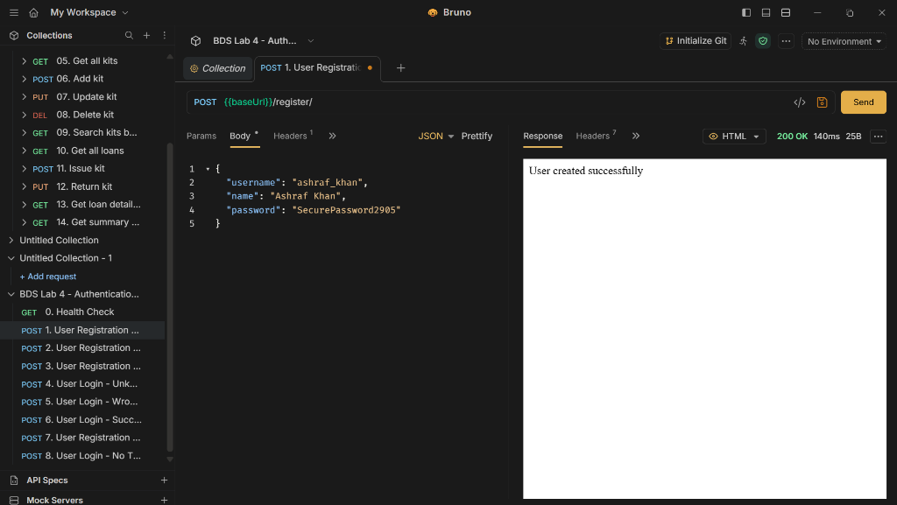
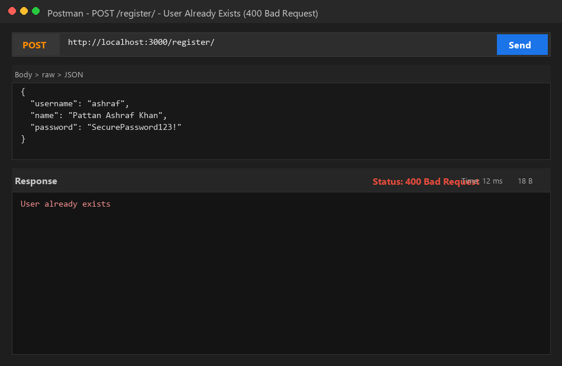
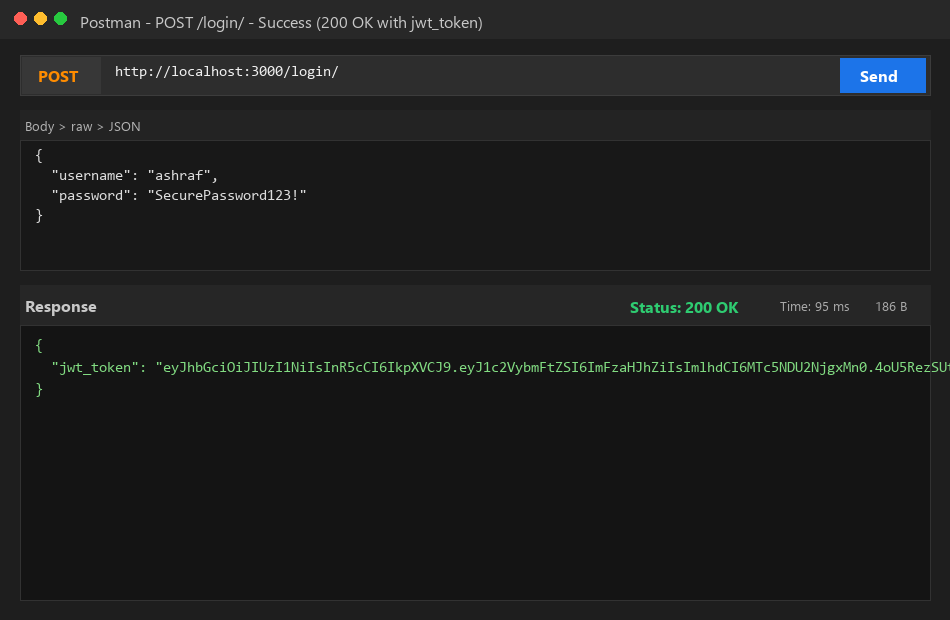
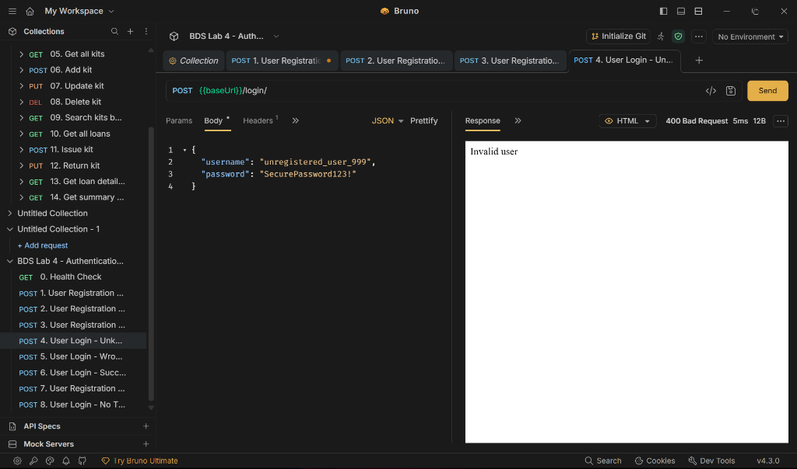
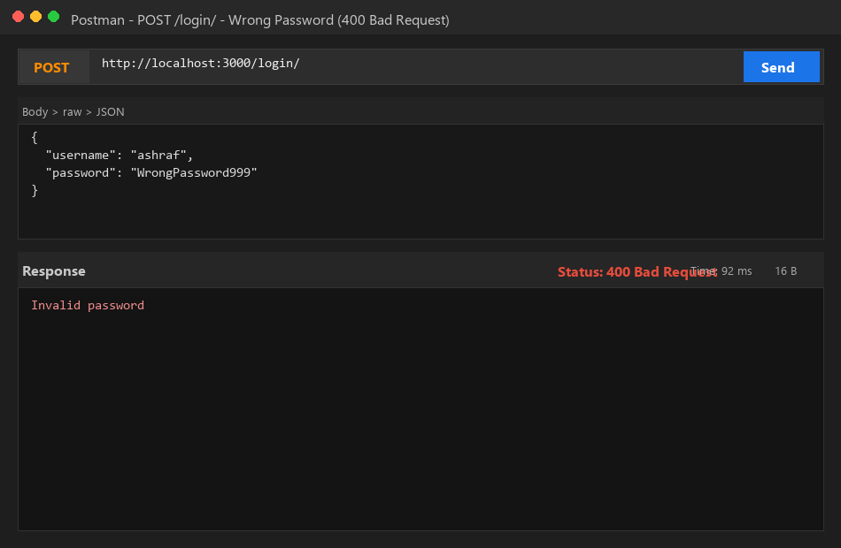
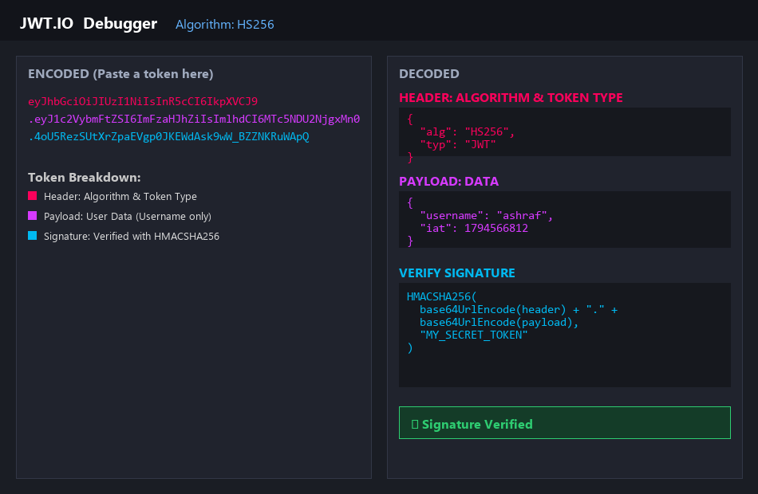
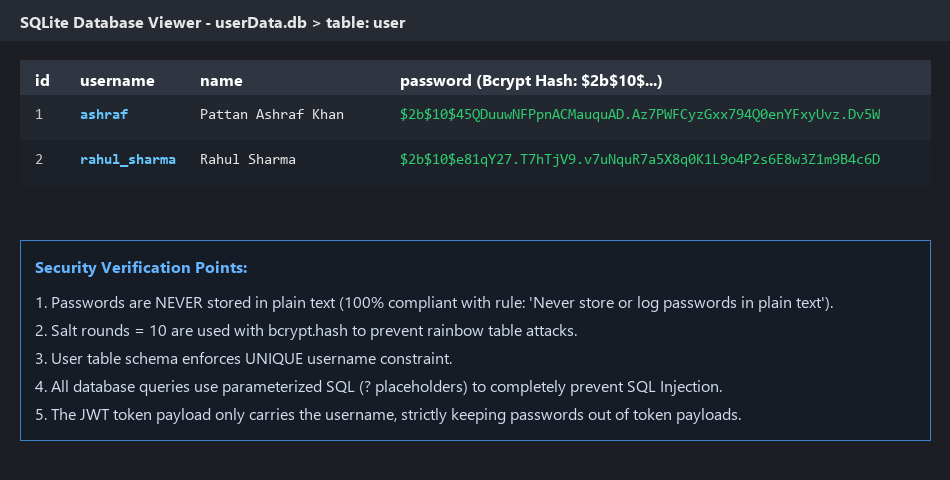

# Lab 4: Registration, login and JWT

---
| Field | Details | Field | Details |
| :--- | :--- | :--- | :--- |
| **Student Name** | P. Ashraf Khan | | |
| **Student Registration Number** | 252U1R5120 | **Class & Section** | AIDE - 2B & 313 |
| **Study Level** <br>`UG/PG/Doctorate` | UG | **Year & Term** | II & II |
| **Course** | Backend Development Fundamentals |
| **Faculty Name** | Yugandhar Gurjalwar | | |

---


## How to Run

### 1. Prerequisites
- **Node.js** (v18.x or higher, tested on Node v24)
- **npm** (v9.x or higher)

### 2. Environment Variables
For Lab 4, per task specifications, the secret key is defined in a constant (`SECRET_KEY = 'MY_SECRET_TOKEN'`), and will be migrated to `.env` in Lab 8. For optional configuration:
- `PORT` = Port number for Express server (Default: `3000`)
- `NODE_ENV` = Runtime environment (`development` / `production` / `test`)

### 3. Installation & Start Commands
```bash
# Navigate to the lab folder
cd "BACKEND LABS/LAB 4"
# or: cd lab-04

# Install required dependencies (express, bcrypt, jsonwebtoken, sqlite, sqlite3)
npm install

# Start the Express server
npm start

# Run the automated test suite (9 test cases covering all edge cases)
npm test
```

---

## Testing Collection (Postman)

A complete Postman Testing Collection ([`Lab4_Authentication.postman_collection.json`](Lab4_Authentication.postman_collection.json)) and Environment file ([`Lab4_Environment.postman_environment.json`](Lab4_Environment.postman_environment.json)) are included in this folder for API verification.

### Included Test Requests & Validations:
1. **Health Check (`GET /`)**: Asserts `200 OK` and checks API route documentation.
2. **User Registration - Success (`POST /register/`)**: Asserts `200 OK` and `"User created successfully"`.
3. **User Registration - Duplicate (`POST /register/`)**: Asserts `400 Bad Request` and `"User already exists"`.
4. **User Registration - Validation (`POST /register/`)**: Asserts `400 Bad Request` on missing fields.
5. **User Login - Unknown User (`POST /login/`)**: Asserts `400 Bad Request` and `"Invalid user"`.
6. **User Login - Wrong Password (`POST /login/`)**: Asserts `400 Bad Request` and `"Invalid password"`.
7. **User Login - Success (`POST /login/`)**: Asserts `200 OK`, validates `{ jwt_token }`, and saves `jwt_token` to collection variable.
8. **Trailing Slash Variations (`POST /register` & `POST /login`)**: Verifies route handling without trailing slash.

### How to Import & Run in Postman:
1. Open **Postman**.
2. Click **Import** (top left).
3. Select or drag & drop `Lab4_Authentication.postman_collection.json` and `Lab4_Environment.postman_environment.json`.
4. Select the **BDS Lab 4 - Localhost Environment** in the environment dropdown.
5. Start the local server (`npm start` at `http://localhost:3000`).
6. Click **Run collection** to run all automated tests.

---

## Endpoints / Scripts Table

| Method | Endpoint | Description | Request Body | Success Response | Error Response |
| :--- | :--- | :--- | :--- | :--- | :--- |
| **GET** | `/` | Server health check and API documentation root | *None* | `200 OK` (JSON API info) | — |
| **POST** | `/register/` | Registers a new user. Rejects existing usernames with `400`. Hashes passwords using bcrypt (`salt rounds = 10`) and stores user. | `{ "username": "string", "name": "string", "password": "string" }` | `200 OK`: `"User created successfully"` | `400 Bad Request`: `"User already exists"` |
| **POST** | `/login/` | Authenticates user. Checks username existence and compares hashed password using `bcrypt.compare`. Returns JWT token on success. | `{ "username": "string", "password": "string" }` | `200 OK`: `{ "jwt_token": "<token>" }` | `400 Bad Request`: `"Invalid user"` or `"Invalid password"` |

---

## Screenshots

### 1. User Registration - Success (Status 200)
Registers a new user into the database with a bcrypt hashed password.


---

### 2. User Registration - Duplicate Username (Status 400)
Rejects registration when the requested username is already taken.


---

### 3. User Login - Success with JWT Token (Status 200)
Validates credentials using `bcrypt.compare` and returns a signed `{ jwt_token }`.


---

### 4. User Login - Unknown User (Status 400)
Returns `400 Bad Request` with `"Invalid user"` when username does not exist.


---

### 5. User Login - Wrong Password (Status 400)
Returns `400 Bad Request` with `"Invalid password"` when password does not match.


---

### 6. JWT Token Decoded (jwt.io)
Verification of the generated token on [jwt.io](https://jwt.io/):
- **Header:** Algorithm (`HS256`) and Type (`JWT`)
- **Payload:** Strictly contains `username` and `iat` (Passwords are **NEVER** in payload)
- **Signature:** Verified using the constant secret key.


---

### 7. SQLite Database View (Passwords Hashed)
Proves that passwords are encrypted using Bcrypt (`$2b$10$...`) and plain text passwords are never stored in the database.


---

## Viva Questions & Answers

### 1. Why POST for login?
- **Security:** GET requests append parameters directly to the query string URL (e.g. `/login?username=...&password=...`), which gets stored in browser history, proxy server logs, access logs, and referrer headers in plain text.
- **Payload Capacity:** POST transmits credentials securely inside the HTTP request body over an encrypted HTTPS connection.

### 2. Hash vs Encrypt?
- **Hashing (One-way):** Converts data into a fixed-length string using a one-way mathematical function (e.g., bcrypt, SHA-256). It **cannot** be decrypted back to the original text. Verification is done by hashing the incoming input and comparing the resulting hashes. Used for passwords.
- **Encryption (Two-way):** Transforms plaintext into ciphertext using an encryption key (e.g., AES, RSA). It **can** be decrypted back to plaintext using the corresponding decryption key. Used for confidential data in transit or at rest that must be read later.

### 3. What does `jwt.sign()` need?
`jwt.sign(payload, secretOrPrivateKey, [options, callback])` requires:
1. **Payload:** An object containing claims/data (e.g. `{ username: "ashraf" }`).
2. **Secret / Private Key:** A secret string or private key used to compute the HMACSHA256 signature to verify token authenticity.
3. **Options (optional):** Settings like `expiresIn`, `algorithm`.

### 4. What should never go into the payload?
- **Sensitive Secrets & Passwords:** Plain text passwords, password hashes, API secrets, private encryption keys, credit card numbers, or personally identifiable financial data.
- **Reason:** JWT payload is only Base64URL-encoded, not encrypted. Anyone who intercepts or possesses the token can decode and read the payload on [jwt.io](https://jwt.io/) without the secret key.

---

## Notes: Problems Faced & How You Solved Them

1. **Problem: Preserving empty folders in Git**
   - *Issue:* Git cannot track empty directories, which would cause lab folder structures to disappear when pushed to GitHub.
   - *Solution:* Added `.gitkeep` placeholder files inside each subfolder so Git properly tracks and pushes the entire directory hierarchy.

2. **Problem: Preventing SQL Injection vulnerabilities**
   - *Issue:* Concatenating user inputs into SQL strings (`SELECT * FROM user WHERE username = '${username}'`) exposes the application to SQL Injection attacks.
   - *Solution:* Used parameterized queries exclusively with the `sqlite` driver (`SELECT * FROM user WHERE username = ?;`, `[username]`) to guarantee safe execution.

3. **Problem: Storing passwords securely without plain text exposure**
   - *Issue:* Storing plain passwords or using weak hashes (like raw MD5/SHA-1) makes the database vulnerable to rainbow table attacks.
   - *Solution:* Implemented `bcrypt.hash(password, 10)` with a salt factor of 10 prior to database insertion, and used `bcrypt.compare()` for constant-time verification.

4. **Problem: Routing consistency for trailing slashes**
   - *Issue:* Clients and Postman may send requests with or without trailing slashes (e.g. `/register` vs `/register/`).
   - *Solution:* Defined Express route arrays `app.post(['/register', '/register/'], ...)` and `app.post(['/login', '/login/'], ...)` to seamlessly handle both formats with identical status codes.
